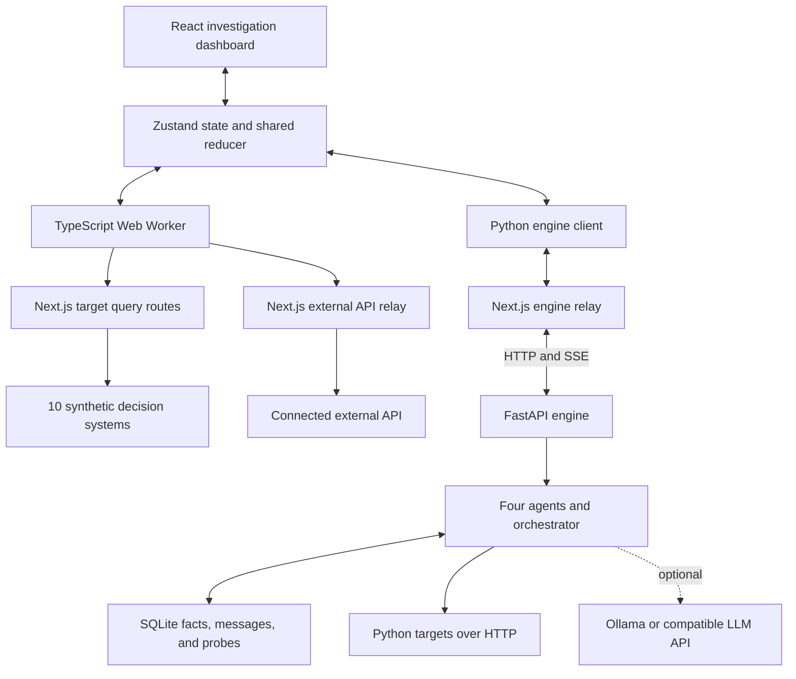

# AUTOPSY: Tech Stack, Architecture, and Working

This overview describes the implementation inspected on November 1, 2026. Dependency versions are taken from repository declarations; some use version ranges.

## 1. What the Project Does

AUTOPSY investigates black-box decision systems through their HTTP APIs. A target accepts structured inputs and returns a numeric result. AUTOPSY designs experiments, queries the target, tests possible explanations, and produces an evidence-backed **Hidden Rulebook** and an interpretable prediction model.

Example questions include:

- Does a pricing API charge more for a particular device?
- Does a credit system reject applicants above a debt threshold?
- Does an input matter only when another condition is met?
- Which documented inputs have no detectable effect within the tested range?

The findings describe observed behavior. They do not recover the original source code.

## 2. Technology Stack

| Layer | Technology | Purpose |
|---|---|---|
| Web framework | Next.js 16.4.3, App Router | Pages, layouts, and server API routes |
| UI | React 19.3.0 | Interactive dashboard and investigation workspace |
| Language | TypeScript 5, strict mode | Frontend, browser engine, and Next.js server code |
| Styling | Tailwind CSS 4 and custom CSS | Layout, theme, responsive UI, and semantic colors |
| UI primitives | Radix UI | Dialogs, selects, sliders, tabs, and tooltips |
| State management | Zustand 5 | Targets, investigations, observations, and controls |
| Workspace visualization | React Flow / `@xyflow/react` 12 | Investigation canvas |
| Data visualization | D3 array, force, hierarchy, scale, and shape modules | Graph layouts, trees, and charts |
| Animation | Motion 14 | Interface animation and transitions |
| Icons | Lucide React | Interface icons |
| Resizable panels | react-resizable-panels 4 | Adjustable workspace layout |
| Styling helpers | clsx and tailwind-merge | Conditional classes and class merging |
| Browser computation | Web Workers | Investigation work outside the main UI thread |
| Python runtime | Python >=3.11, <3.13 | Backend investigation engine |
| Python API | FastAPI and Uvicorn | Runs, controls, target discovery, and event streaming |
| Validation | Pydantic 2 | Python request models |
| HTTP client | HTTPX | Python requests to targets, models, and remote memory |
| Scientific computation | NumPy, pandas, and SciPy | Statistical analysis and data processing |
| Machine learning | scikit-learn | Decision-tree surrogate and credit target model |
| Causal analysis | DoWhy | Refutation checks and proxy analysis |
| Backend storage | SQLite | Agent facts, messages, and raw probe results |
| Optional remote memory | Meko over MCP | Remote mirroring of agent facts and messages |
| Optional language model | Ollama or an OpenAI-compatible endpoint | Persona generation and report wording |
| Realtime transport | Server-Sent Events (SSE) | Python engine updates to the browser |
| Testing | Vitest 3 and pytest | TypeScript and Python tests |
| Quality checks | ESLint 9 and the TypeScript compiler | Linting and type checking |
| Package management | npm and uv | JavaScript and Python dependencies |

Dependency sources: [package.json](package.json) and [backend/pyproject.toml](backend/pyproject.toml).

## 3. Architecture: Two Investigation Engines

AUTOPSY has two execution paths, both connected to the same dashboard.

| Aspect | Browser engine | Python engine |
|---|---|---|
| Location | `src/lib/engine/` | `backend/autopsy/` |
| Execution | TypeScript Web Worker | Python background thread |
| Targets | Built-in synthetic targets and connected external APIs | Configured Python targets |
| Coordination | Programmed investigation phases | Four agents communicating through a shared blackboard |
| Language model | None | Optional for Persona and Reporter |
| Statistics | Custom TypeScript procedures | Python scientific libraries and custom procedures |
| Surrogate model | Custom CART-style regression tree | scikit-learn decision tree |
| Active learning | Bootstrap ensemble disagreement and diversity | Prioritizes uncertain feature contrasts |
| Updates | Worker messages | SSE through the Next.js relay |

The selection occurs in [src/lib/store.ts](src/lib/store.ts). Targets with `origin: "python"` use `PythonEngineHandle`; the other targets use a Web Worker.



## 4. End-to-End Investigation Workflow

1. **Choose or connect a target.** Its public definition specifies fields, numeric ranges, categorical options, output format, endpoint, and default budget. External connections also specify authentication headers, request mode, and output extraction settings.
2. **Create an investigation.** The app assigns an ID, target, seed, query budget, execution pace, and initial state.
3. **Generate diverse subjects.** Synthetic input profiles, called personas, cover the target's input space.
4. **Measure baseline behavior and noise.** Repeated identical queries estimate natural output variability.
5. **Run controlled experiments.** The engine changes individual fields, sweeps numeric ranges, and tests selected combinations.
6. **Evaluate hypotheses.** Statistical procedures classify explanations as supported, rejected, or inconclusive.
7. **Choose useful follow-up queries.** Active learning directs additional budget toward uncertainty.
8. **Fit an interpretable surrogate.** A small decision tree approximates the target from observed inputs and outputs.
9. **Publish the Hidden Rulebook.** Findings include evidence, effect sizes, uncertainty, and limitations.
10. **Verify and export.** Analysts can run fresh checks, compare with available ground truth, benchmark, and export Markdown or JSON.

## 5. Browser Engine Investigation Protocol

The main implementation is [src/lib/engine/orchestrator.ts](src/lib/engine/orchestrator.ts).

| Phase | Operations | Purpose |
|---|---|---|
| Reconnaissance | Latin-hypercube sampling, baselines, replicate probes, validation and test samples | Establish coverage and output variability |
| Screening | Counterfactual pairs for each field | Identify influential inputs |
| Structure | Dose-response sweeps, model comparison, threshold localization, fresh confirmation | Determine the shape of effects |
| Interactions | 2x2 factorial experiments | Identify effects dependent on another factor |
| Active learning | Query points where models disagree | Improve coverage in uncertain regions |
| Synthesis | Final surrogate fit and report assembly | Publish supported findings |

### Counterfactual Pairs

Two profiles have identical inputs except for one field:

```text
Profile A: device = Android -> price = 200
Profile B: device = iPhone  -> price = 224
```

One pair suggests a difference. Repeating the comparison across subjects and noisy responses supports an estimate of the effect and its uncertainty.

### Threshold Detection

If output changes sharply near a numeric value, the engine compares response shapes and can use bisection to narrow the threshold interval. Fresh subjects provide a confirmation check when budget allows.

### Interaction Detection

A 2x2 design compares four conditions:

| | Earlier hour | Later hour |
|---|---|---|
| Weekday | A | B |
| Weekend | C | D |

The engine asks whether the later-hour effect changes on weekends. It also examines effect scale so ordinary multiplicative composition is not automatically treated as a special conditional rule.

## 6. Statistical Methods

| Method | Meaning |
|---|---|
| Bootstrap confidence intervals | Estimate uncertainty by repeatedly resampling observations |
| Sign-flip permutation tests | Test whether paired differences are distinguishable from zero |
| Equivalence checks | Assess whether effects are small enough to count as practically negligible |
| Randomized null audits | Challenge preliminary no-detectable-effect findings |
| BIC model comparison | Compare simpler and more complex explanations of response shape |
| Difference-in-differences | Test whether an effect depends on another factor |
| Benjamini-Hochberg adjustment, Python engine | Adjust for testing many contrasts |
| DoWhy refuters, Python engine | Check sensitivity to shuffled treatment, random confounders, and subsets |

The engines have different implementations and safeguards. They should not be assumed to return identical findings for the same target.

Core sources:

- [Browser statistics](src/lib/engine/stats.ts)
- [Browser experiment design](src/lib/engine/design.ts)
- [Python statistics](backend/autopsy/stats.py)
- [Python causal checks](backend/autopsy/causal.py)

## 7. The Four Agents

| Agent | Responsibility |
|---|---|
| Persona | Creates diverse subjects and supplies matched subjects for experiments |
| Experimenter | Designs and executes target probes |
| Statistician | Measures noise, evaluates effects, proposes follow-ups, and fits models |
| Reporter | Converts supported evidence into readable rules |

In the browser engine, these are deterministic roles within the programmed workflow.

In Python, separate agent classes communicate through messages. The orchestrator selects the agent addressed by the oldest open message, runs its turn, and continues processing requests. It also handles budget, pause, cancellation, and run status.

A message has a structure such as:

```json
{
  "from": "statistician",
  "to": "experimenter",
  "type": "confirm",
  "content": {},
  "reason": "Confirm the effect on fresh personas"
}
```

Shared facts contain conclusions, such as noise estimates and feature effects. Raw observations are stored separately.

The project uses custom orchestration. Its declared dependencies do not include LangChain, CrewAI, or AutoGen.

Sources: [Python orchestrator](backend/autopsy/orchestrator.py), [agents](backend/autopsy/agents), and [shared memory](backend/autopsy/memory.py).

## 8. Optional LLM Integration

The default configuration uses Ollama with `qwen2.5:3b`. An OpenAI-compatible endpoint is also supported.

LLM responsibilities are limited to:

- Generating personas, with schema validation.
- Writing plain-language statements from recorded facts.

Statistical calculations remain code-based. If the model is disabled or unavailable, seeded sampling and templates provide fallbacks. An LLM service is therefore optional.

Implementation: [backend/autopsy/llm.py](backend/autopsy/llm.py).

## 9. Surrogate Models and Evaluation

A surrogate approximates the investigated target from collected probe data. It is separate from the target itself.

```text
Debt ratio above threshold?
|-- Yes: predict a very low credit limit
`-- No:
    |-- Short credit history: predict a reduced limit
    `-- Longer history: predict a higher limit
```

The dashboard exposes tree structure, feature importance, predictions, residuals, and fidelity metrics.

| Metric | Interpretation |
|---|---|
| R² | How much evaluation-sample output variation the surrogate explains |
| MAE | Average absolute prediction error |
| RMSE | Prediction error with greater weight on large misses |

A high R² indicates predictive agreement on the evaluation sample. It does not establish complete hidden-rule recovery.

The browser engine separates a monitoring validation set from a sealed final test set. The Python implementation evaluates intermediate surrogate versions against its holdout, so it does not have the same final-test protocol.

Sources: [browser tree implementation](src/lib/engine/tree.ts) and [Python surrogate](backend/autopsy/surrogate.py).

## 10. Available Targets

### Built-In Synthetic Targets

| Target ID | Display name |
|---|---|
| `meridian-credit` | Credit Limit |
| `vela-pricing` | Ride Fare |
| `halo-ranker` | Social Feed Ranking |
| `talon-hiring` | Resume Screening |
| `bastion-auto` | Car Insurance Price |
| `sentinel-fraud` | Fraud Detection |
| `arbiter-pretrial` | Bail Risk Score |
| `caduceus-care` | Patient Priority |
| `keystone-tenant` | Rental Screening |
| `aisle-buybox` | Seller Ranking |

These run in the Next.js server. Their decision logic is not delivered to the browser investigation engine.

For example, the synthetic credit-limit system includes a debt-to-income rejection gate, income-based limits, credit-history and inquiry penalties, employment and regional effects, a mortgage adjustment, and noise.

Implementation: [src/server/targets.ts](src/server/targets.ts).

**Documentation discrepancy:** the root README describes three built-in targets; the inspected code contains the 10 listed above.

### Python Targets

| Target | Implementation |
|---|---|
| Ride Pricing API | Rule-based rupee pricing with device, age, postcode, weekend/hour effects, and noise |
| Credit Approval Model | Random forest trained on the bundled UCI German Credit dataset |

The pricing target includes an iPhone multiplier, an age-above-60 surcharge, a weekend-and-late-hour multiplier, and premium-postcode pricing. Some fields are deliberate decoys with no direct effect.

The credit target returns a score from 0 to 100 and an approval boolean based on a score threshold of 50. The investigation analyzes its numeric score. Its random forest uses 300 trees, maximum depth 6, and minimum leaf size 5. The reveal endpoint describes feature influence through permutation importance rather than a short exact formula.

### Blind Challenges

The project includes a sample loan-APR challenge and an example standalone challenge server. Another person can write secret rules, share only the endpoint and public schema, then reveal the rules after an investigation.

The bundled sample is a demonstration, not independent validation.

Sources: [blind-challenge guide](docs/BLIND_CHALLENGE.md) and [example server](examples/blind-challenge-server.mjs).

## 11. Frontend Pages

| Route | Purpose |
|---|---|
| `/` | Landing page and interactive demonstrations |
| `/lab` | Investigation registry and launch interface |
| `/connect` | Define and test external connections |
| `/demo` | Guided demonstration |
| `/targets` | Target information |
| `/agents` | Agent explanations |
| `/method` | Investigation methodology |
| `/benchmarks` | Benchmark information |
| `/docs` | Usage documentation |
| `/live` | Live-console page |
| `/lab/[id]` | Main investigation workspace |
| `/lab/[id]/agents` | Agent tasks and communication |
| `/lab/[id]/experiments` | Experiment designs and observations |
| `/lab/[id]/hypotheses` | Hypothesis map and evidence status |
| `/lab/[id]/learning` | Active-learning rounds and benchmark controls |
| `/lab/[id]/surrogate` | Surrogate tree and fidelity |
| `/lab/[id]/rulebook` | Findings, verification, reveal, and exports |

The UI uses cyan for observations, violet for hypotheses and models, lime for supported findings, amber for uncertainty, and rose for errors or rejected explanations. It includes reduced-motion support and responsive navigation.

Fonts include Geist, Geist Mono, Geist Pixel, and Instrument Serif through `next/font/google`.

## 12. State and Event Flow

```text
Engine emits typed events
        |
        v
Shared reducer updates investigation state
        |
        v
Zustand publishes state
        |
        v
React views update
        |
        v
Case state is periodically saved locally
```

Events represent observations, experiments, hypotheses, tasks, handoffs, logs, reports, models, progress, and status changes.

The browser worker and UI share state-transition logic. Python emits the event shape understood by the same UI reducer.

Sources: [types](src/lib/types.ts), [reducer](src/lib/engine/reducer.ts), [store](src/lib/store.ts), and [Python client](src/lib/python-engine.ts).

## 13. Storage and Persistence

| Location | Information |
|---|---|
| Browser localStorage | Investigation index, case state, external target definitions |
| Browser memory | Session credentials and active runtime handles |
| SQLite `facts` table | Shared agent conclusions |
| SQLite `messages` table | Agent requests and handling status |
| SQLite `probes` table | Inputs, outputs, experiments, personas, timestamps |
| Python process memory | Active run objects and event channels |

The default database path is `backend/data/autopsy.db`. SQLite records are associated with a run ID.

Browser persistence trims large logs and some visualization data. Under storage pressure, it can evict older non-running case data.

Reloading marks previously active browser cases as **interrupted**; running workers are not restored. Python facts and probes persist, but active run objects and event channels are not automatically reconstructed after a backend restart.

Meko mode mirrors agent facts and messages remotely over MCP. Routing uses a local in-memory SQLite mirror, and remote failures are handled on a best-effort basis.

## 14. External API Contract

Targets must accept structured numeric/categorical inputs and provide one numeric output per input.

### Batch Mode

Request:

```json
{
  "inputs": [
    { "income": 52000, "segment": "b" },
    { "income": 18000, "segment": "a" }
  ]
}
```

Response:

```json
{
  "outputs": [61.5, 22.0]
}
```

### Single-Input Mode

Request:

```json
{
  "input": {
    "income": 52000,
    "segment": "b"
  }
}
```

An output path such as `result.score` tells AUTOPSY where to extract the number. Batch responses must preserve input order and return the correct count. Numeric strings are rejected.

### Relay Behavior

The browser calls `/api/proxy`, and Next.js calls the upstream API. Browser CORS access to the external target is therefore unnecessary for this workflow.

The relay implements:

- HTTPS requirements in production.
- Private and reserved address blocking by default.
- DNS checks at connection time.
- Redirect refusal.
- A 10-second upstream timeout.
- A 1 MB response limit.
- Up to 64 inputs per relay call.
- Four concurrent upstream requests in single-input mode.
- Bounded retries for selected transient failures.
- Response type and count validation.

Credentials stay in browser memory, are forwarded as a configured request header, and are excluded from persisted cases and exports. They must be re-entered after reload.

Sources: [full API contract](docs/API_CONTRACT.md), [connection validation](src/lib/connection.ts), [target adapter](src/lib/adapter.ts), and [relay](src/server/proxy.ts).

## 15. API Endpoints

### Next.js

| Endpoint | Purpose |
|---|---|
| `GET /api/targets` | List built-in public schemas |
| `GET /api/targets/[id]` | Retrieve a target schema |
| `POST /api/targets/[id]/query` | Query a built-in target |
| `POST /api/proxy` | Query an external API |
| `/api/challenge/[id]` | Sample challenge endpoint |
| `/api/challenge/[id]/reveal` | Sample challenge ground truth |
| `/api/engine/[...path]` | Relay to the Python API |

### Python Engine

| Endpoint | Purpose |
|---|---|
| `GET /health` | Engine, target, LLM, memory, and DoWhy status |
| `GET /targets` | Public Python target specifications |
| `POST /runs` | Start an investigation |
| `GET /runs/{id}/events` | Stream investigation events |
| `POST /runs/{id}/pause` | Pause a run |
| `POST /runs/{id}/resume` | Resume a paused run |
| `POST /runs/{id}/cancel` | Cancel a run |
| `GET /runs/{id}/scorecard` | Compare findings with ground truth after stopping |
| `POST /targets/{id}/query` | Manual target queries |
| `POST /benchmark` | Start an active-versus-random benchmark |
| `GET /benchmark/{id}/events` | Stream benchmark events |
| `POST /benchmark/{id}/cancel` | Cancel a benchmark |

Python updates use SSE. The browser client reports an error and closes the stream on connection loss; automatic stream recovery is not implemented.

Implementation: [backend/autopsy/api.py](backend/autopsy/api.py).

## 16. Query Budgets and Benchmarks

Budget counts evaluated inputs, while HTTP requests are tracked separately. A batch of 20 inputs costs 20 queries even if sent in one HTTP request. Retries can increase request counts.

The browser engine reserves approximately 4% of its investigation budget for analyst probes and verification. Benchmark queries have separate accounting and can create many additional upstream calls.

| Benchmark | Evaluation |
|---|---|
| Browser | Adaptive versus random sampling using prediction RMSE on shared evaluation data |
| Python | Active versus random agent runs, including ground-truth rule recovery and predictive error |

Benchmarks issue real queries. The browser implementation uses bootstrap-ensemble uncertainty and diversity for adaptive selection. Python prioritizes open contrasts using confidence-interval width in noise units and estimated evidence for a nonzero effect.

Sources: [browser benchmark](src/lib/engine/benchmark.ts) and [Python benchmark](backend/autopsy/benchmark.py).

## 17. Reports, Verification, and Ground Truth

A rule can contain:

- A readable statement and effect size.
- A confidence interval and statistical test.
- Supporting observations and experiment references.
- Fresh-subject confirmation status.
- Rejected alternatives and limitations.
- Python refutation results and evidence badges where applicable.

The analyst can run fresh verification queries against findings. Ground-truth workflows support either available target reveals or operator-entered rules and verdicts.

Markdown and JSON exports contain investigation metadata, findings, evidence summaries, query accounting, and optional ground-truth comparisons. Sensitive-input flags use field-name heuristics; they do not independently establish unfairness.

Report implementation: [src/lib/report.ts](src/lib/report.ts).

## 18. Running the Project

### Web App

The root README specifies Node.js 20 or newer.

```bash
cd /home/pranshu/autopsy
npm install
npm run dev
```

Open `http://localhost:3000`. Built-in and external-target browser workflows do not require Python.

### Python Engine and Targets

Install `uv` if needed, then run in another terminal:

```bash
cd /home/pranshu/autopsy/backend
uv sync
AUTOPSY_LLM=off uv run python run.py
```

The `AUTOPSY_LLM=off` setting runs without a model service. Omit it to use the configured provider and its fallback behavior.

| Service | Default address |
|---|---|
| Web app | `http://localhost:3000` |
| Python engine | `http://127.0.0.1:8000` |
| Python targets | `http://127.0.0.1:8100` |
| Optional Ollama | `http://127.0.0.1:11434` |

### Terminal-Only Investigation

Start the targets first, then:

```bash
cd backend
uv run python -m autopsy.cli pricing --budget 500 --seed 42 --no-llm
```

Random baseline:

```bash
uv run python -m autopsy.cli pricing --strategy random --seed 42 --no-llm
```

Benchmark:

```bash
uv run python -m autopsy.cli pricing --benchmark --seeds 3
```

### Production Web Build

```bash
npm run build
npm start
```

Python-backed investigations also require reachable engine and target services. The engine relay destination is configured through `AUTOPSY_ENGINE_URL`.

## 19. Configuration

| Environment variable | Default or purpose |
|---|---|
| `AUTOPSY_ENGINE_URL` | Next.js relay destination; defaults to `http://127.0.0.1:8000` |
| `AUTOPSY_TARGETS_URL` | Python target host; defaults to `http://127.0.0.1:8100` |
| `AUTOPSY_TARGETS` | Target IDs; defaults to `pricing,credit` |
| `AUTOPSY_LLM` | `ollama`, `openai`, or `off`; defaults to `ollama` |
| `AUTOPSY_LLM_MODEL` | Defaults to `qwen2.5:3b` |
| `AUTOPSY_LLM_URL` | Defaults to `http://127.0.0.1:11434` |
| `AUTOPSY_LLM_API_KEY` | Optional compatible-API credential |
| `AUTOPSY_LLM_TIMEOUT` | Defaults to 60 seconds |
| `AUTOPSY_MEMORY` | `sqlite` or `meko`; defaults to `sqlite` |
| `AUTOPSY_MEKO_URL` | Meko MCP endpoint |
| `AUTOPSY_MEKO_TOKEN` | Meko authentication token |
| `AUTOPSY_DATA_DIR` | Backend data directory; defaults to `backend/data` |
| `AUTOPSY_TARGET_SEED` | Reproducible mock pricing noise |
| `AUTOPSY_ALLOW_PRIVATE_TARGETS` | Set to `1` to allow private external destinations |

Private external destinations are also allowed by the relay's development policy.

Source: [backend configuration](backend/autopsy/config.py).

## 20. Repository Map

```text
src/app/                 Next.js pages, layouts, and API routes
src/components/lab/      Investigation workspace and result views
src/components/site/     Public informational pages
src/components/landing/  Landing experience
src/components/viz/      Visualization components
src/lib/engine/          Browser investigation engine
src/lib/store.ts         Frontend state and persistence
src/lib/adapter.ts       Target-query abstraction
src/lib/report.ts        Reports and exports
src/server/              Synthetic targets and external relay

backend/autopsy/         Python engine and API
backend/autopsy/agents/  Four agent implementations
backend/targets/         Python pricing and credit systems
backend/tests/           Python tests

tests/                   TypeScript tests
docs/                    API contract and challenge instructions
examples/                Standalone challenge server
public/demo/             Saved demonstration recording
```

The Next.js configuration enables `cacheComponents`, `partialPrefetching`, and the Tailwind Turbopack CSS loader. TypeScript uses strict checking and the `@/*` alias for `src/*`.

The repository's `AGENTS.md` requires reading the installed Next.js guides before writing Next.js code because the installed version can differ from familiar conventions.

## 21. Current Limits and Operational Behavior

- The documented contract supports structured numeric/categorical inputs and a numeric output. Text generation, images, and arbitrary stateful workflows are outside its scope.
- Findings depend on tested ranges, sampling, noise, and query budget. Rare or complex interactions can be missed.
- No detectable effect is scoped to the experiment; it is not proof an input never matters.
- Built-in examples demonstrate functionality. Independent targets are needed to evaluate generalization.
- Reproducibility also depends on target noise and optional LLM behavior, beyond the investigation seed.
- Browser cases are local to the browser; they are not synchronized user accounts.
- The inspected routes do not include an application login, tenant isolation, or user authorization layer.
- Python run orchestration and event channels live in one process, without automatic reconstruction after restart.
- Browser reload does not restore running workers.
- Runtime pace changes work in the browser engine; the Python client currently ignores pace-change commands.
- The two engines differ in active learning, statistics, evaluation protocol, and benchmark behavior.

## 22. Verification Results

During the inspection associated with this overview:

| Check | Result |
|---|---|
| `npm run typecheck` | Passed |
| `npm test` | 53 tests passed across 7 files |
| Python `pytest -q` | 11 tests passed |
| Production build | Not run |
| Browser UI audit | Not run |

Integration tests required local networking outside the restricted sandbox. Initial sandbox socket restrictions were resolved by rerunning with local networking enabled.

The tests cover connection validation, adapters, proxy protections and behavior, investigation execution, reports, verification statistics, benchmark verdicts, Python statistics, agent isolation, memory, target contracts, and a complete pricing investigation.
